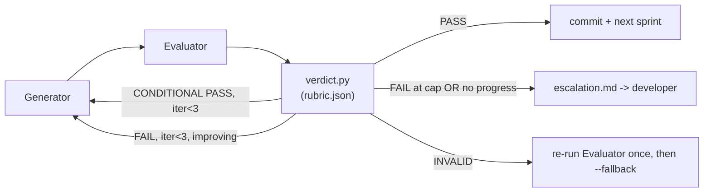

# The Harness Design Brief

StoreOps development harness — architectural intent, governance design, and the strategy for
turning variable LLM output into deterministic accept/reject decisions. Written against the
harness as built in this repository (`CLAUDE.md`, `.harness/`), not as an abstract proposal —
every claim below cites a real file, rule, or run from this build.

---

## Section A — Intent Decomposition

**Worked example: "Add planogram task template"** — `POST /api/programmes/{id}/templates`,
cloning a fixed set of `PLANOGRAM` activities into a programme with department assignments and
default priorities (`.harness/reviews/20261023-1241-planogram-task-template/spec.md`).

### Why the sprint boundary was drawn where it was

The Planner follows a fixed ordering rule (`sprint-decomposition/SKILL.md §1`): **model →
repository/service rules → route → cross-module side effects**, with a hard cap of two
modules per sprint. For this feature that produced exactly two sprints:

- **Sprint 1 (`activities` only)** — the new `ActivityCategory.PLANOGRAM` value, the additive
  `Activity.department` field, a fixed in-code template catalog (`activities/templates.py`),
  `ActivityService.clone_template_into_programme`, and the `ActivitiesTemplateCloned` event.
  No route, no HTTP surface. This is deliberate: a service-level sprint can be fully verified
  by unit tests against the repository directly, with no FastAPI/pydantic noise in the
  acceptance criteria. If something is wrong with the business rule (store isolation, which
  template fields map where), it fails here, cheaply, before any route code exists to confuse
  the diagnosis.
- **Sprint 2 (`activities` + `reports`)** — the HTTP route, request/response schemas, and the
  `reports` subscriber that counts clones. This sprint exists specifically to prove the
  *event-driven* side effect works end-to-end over HTTP, which sprint 1's service-level tests
  structurally cannot do (they call the service directly, bypassing the bus's dispatch).

No boundary change was needed for this feature — `reports` only *subscribes*, it never gains a
new import edge. Contrast: the regional-rollup-report feature, planned earlier in this build,
*did* need `reports → activities, staff` added to `ALLOWED_DEPENDENCIES`, and the Planner
surfaced that explicitly as a "Boundary change requiring approval" line in its spec, gated on
developer sign-off before any code was written. The decomposition process is the same either
way; only the output differs based on what the feature actually requires.

### What makes a criterion testable, not subjective

Every acceptance criterion is GIVEN/WHEN/THEN, but the discipline is in the THEN clause: it
must name **observable state**, not an impression of correctness. The sprint-decomposition
skill file gives the negative list explicitly — *"returns 200"*, *"works correctly"*, *"handles
errors"* are rejected outright, because they can't be mechanically checked against anything.
A compliant THEN clause instead enumerates exact field values, counts, and event payloads, so
that two independent readers (the Generator, writing the test; the Evaluator, grading it)
converge on the same pass/fail judgment without having to agree on taste. Concretely, the
Evaluator's check L6 asks: *if the implementing code were deleted, would this test still pass?*
A THEN clause written as "returns 200" always survives that deletion test — the assertion never
touches the feature at all — which is exactly the failure mode (status-code-only tests) the
client's standards team flagged from the prior AI experiment.

### One sprint contract entry with its acceptance criterion in full

From `sprint-1-contract.md` of the worked example, quoted verbatim:

> ### AC-1.1 Clone creates the standard planogram task set
> GIVEN programme P exists in store-001 (created via `ProgrammeService.create_programme`) and
> the catalog `"standard_planogram_reset"` defines 4 task entries
> WHEN `ActivityService.clone_template_into_programme(ctx=ALEX/store-001, programme_id=P,
> template_key="standard_planogram_reset")` is called
> THEN it returns exactly 4 new `Activity` objects, each with `category ==
> ActivityCategory.PLANOGRAM`, `status == ActivityStatus.TODO`, `programme_id == P`, `store_id
> == "store-001"`, `created_by == ctx.user_id`, `assignee_id is None`, and
> `department`/`priority` equal to the matching catalog entry (in catalog order)
> AND each returned activity is retrievable unchanged via `ActivityRepository.get(activity.id)`
> AND exactly one `ActivitiesTemplateCloned` event is published with `programme_id == P`,
> `template_key == "standard_planogram_reset"`, `activity_ids` equal to the tuple of the 4
> created ids (catalog order), `created_by == ctx.user_id`

Every clause in that THEN is a value the Generator's test can assert directly and the Evaluator
can re-derive from the diff without trusting either side's narrative.

---

## Section B — Governance Framework

### Skill file strategy

| Skill file | Read by | Encodes (StoreOps-specific, not generic) |
|---|---|---|
| `app-context` | all four agents | the real module map, the brief-vocabulary→code glossary (e.g. brief's "CRITICAL" priority = code's `ActivityPriority.URGENT`; brief's `Report` entity doesn't exist, only `StoreMetrics` counters), the store-isolation rule (`ctx.store_id` on every query) |
| `architecture-principles` | all four agents | the five numbered StoreOps rules (R1–R5) with the exact import paths that are legal vs. forbidden today, and the one legitimate procedure for changing a boundary |
| `sprint-decomposition` | Planner | sizing rules (≤2 modules/sprint), the AC format, the client's own glossary gaps as "domain gaps" the Planner must flag, not silently invent |
| `coding-conventions` | Generator, Evaluator | StoreOps's actual naming (`*Create`/`*Update`/`*Out`), its specific error-code table mapped to `AppError` subclasses, its id-prefix convention (`act_`, `prg_`, `aud_`…) |
| `module-patterns` | Generator, Evaluator | copyable recipes lifted from the real code (`StaffReader`, `ProgrammeReader`) for the Reader-Protocol and event-publish patterns this codebase already uses |
| `how-to-test` | Generator, Evaluator | the exact coverage thresholds per layer (80/70/60/70%), and the StoreOps-specific negative-path checklist (store isolation, auth, permission, partial failure) |
| `how-to-review` | Evaluator | the literal binary question for each L-check, and the evidence-or-fail rule that converts "looks fine" into a forced FAIL |
| `grading-criteria` (+ `rubric.json`) | Evaluator, Monitor | the machine-readable weights/gates that `verdict.py` executes — not advice, an input to a deterministic computation |

`app-context` and `architecture-principles` are shared across all four because every agent
needs the same ground truth about what exists and what is forbidden — a Planner that doesn't
know `staff` has no `region_id` today will under-plan; a Monitor that doesn't know the module
map can't attribute a recurring failure to the right skill.

### `.harness/reviews/` as the audit trail

What it captures, mechanically: `route.py init` freezes the approved `spec.md` and every
sprint contract into `.harness/reviews/<run_id>/` the moment a run starts; `route.py decide`
mirrors each scored iteration's `generator-summary.md`, `evaluator-feedback.md`,
`evaluator-checks.json`, and `verdict.json` into `.harness/reviews/<run_id>/sprint-N/iter-K/`;
the Monitor adds `sprint-N-run-log.md` and one row to `index.md` per sprint. All of it is
committed to git with the code it describes — `.harness/output/` is the only git-ignored
scratch space, and is wiped by the next run. **Who can access it**: anyone with read access to
the repository or its PRs, exactly like the code — no separate system, no retention policy to
configure.

How it surfaces a recurring issue: the Monitor looks up each failed check's `owner_skill` in
`rubric.json` and flags that skill when its checks fail in two or more iterations of the same
sprint, *or* when `index.md` shows the same pattern in an earlier run. Concretely: if `L10`
(StoreOps naming conventions) keeps failing across unrelated features, that's not three
separate Generator mistakes — it's `coding-conventions/SKILL.md` missing an example, and the
audit trail is what makes that visible instead of three isolated retries.

### One rule, stated, and what breaks without it

**Rule (R2, `architecture-principles/SKILL.md`)**: side effects that cross a module boundary
must be raised via `self._bus.publish(<DomainEvent>)`; a module must never import another
module's service to trigger a write on its behalf.

**What breaks without it, demonstrated, not hypothesized** — during this build a deliberately
planted violation (`from storeops.modules.activities.repository import
InMemoryActivityRepository` inside `alerts`) was caught by the automated gate:

```
### A5 findings
- src/storeops/modules/alerts/services/probe.py:3 imports storeops.modules.activities.repository
```

Without R2 enforced, `alerts` or `reports` could reach directly into `activities`' storage,
which reproduces failure mode 4 from the client's prior AI experiment exactly: state changes
written straight into a sibling module's repository, bypassing the event bus, with no single
place left that records *why* the write happened. The import-linter contract (`A5`) catches the
mechanical edge; the LLM check (`L1`) catches the subtler case of a module calling *another
module's service method* to force a write without importing its repository at all — which
`import-linter` cannot see, because no forbidden import exists, only a forbidden method call.

---

## Section C — Non-Determinism Strategy

### Dimensions, weights, and why

| Dimension | Weight | Why this weight, for StoreOps |
|---|---|---|
| D1 — Architecture compliance | 40% | three of the four failure modes named in the client brief (module boundary, event bus, error contract) are architectural; this is the dimension the standards team will not accept any slippage on |
| D2 — Functional correctness & test quality | 35% | the fourth failure mode (status-code-only tests) lives here, and a feature that doesn't work is still a failure even with perfect architecture |
| D3 — Code quality & conventions | 25% | necessary for a maintainable codebase but least tied to the original incident — weighted lowest on purpose, so a mypy nit never outvotes an architecture violation |

### Hard gates — failure mode and why not soft

| Gate | Prevents | Why it cannot be a soft check |
|---|---|---|
| `A5` import-linter | FM1 — direct cross-module repository import | boundary compliance is binary: a "mostly enforced" boundary is a loophole, and the first LLM-granted exception becomes precedent for the next request |
| `A6` raw-raise AST scan | FM2 — raw `Error`/`HTTPException` throws | the error contract exists so every caller gets one predictable JSON shape; one unconverted exception breaks that guarantee exactly where it's least expected (an edge case no one tested) |
| `A9` status-only-test scan, `A10` AC traceability | FM3 — tests that assert the status code and nothing else | a soft version of this check just becomes "the LLM promises it tested well" — the exact leniency the client's standards team is trying to eliminate |
| `A11` event-wiring check | FM4 — declared event never actually published or subscribed | an event that exists only in the contract text is a silent no-op in production; this has no "mostly correct" state — it either fires or it doesn't |
| `A12` protected-files check | governance integrity | if this were advisory, a bad run could edit its own rubric or architecture test mid-loop to make itself pass |

### From variable Generator output to a definitive verdict — a real example

During this build, a sprint seeded with the FM1–FM4 violations above produced this actual,
unedited `verdict.py` output after automated checks and a fallback-scored Evaluator pass:

```
VERDICT: FAIL
SCORE: 12.2 / 100
HARD GATES FAILED: A5, A6, A11, A12, L1, L3, A4, A8, A9, A10, L6, A1
```

The three dimension scores computed from the per-check results were D1 = 0.0, D2 = 10.0,
D3 = 35.0. The verdict rule (`rubric.json → verdict_rules`, executed by `verdict.py`, never by
the Evaluator itself) is:

```
score = 0.40·D1 + 0.35·D2 + 0.25·D3
if any hard check failed or score < 75  → FAIL
elif score ≥ 90 and no major failed     → PASS
else                                     → CONDITIONAL PASS
```

`0.40×0.0 + 0.35×10.0 + 0.25×35.0 = 0 + 3.5 + 8.75 = 12.25 ≈ 12.2`. Because the score is already
far below 75, **and** because `A5` alone is a hard gate failure, the verdict is FAIL by both
branches of the rule independently — the same inputs will produce FAIL every time this is
re-run, regardless of which model graded it or how it phrased its reasoning. The only
genuinely variable input, the Evaluator's L-check judgments, is constrained to a fixed set of
binary questions with an evidence-or-fail rule, so its only degree of freedom is *which* checks
it marks FAIL with evidence — never whether a FAIL verdict can be argued back to a PASS.

### Escalation path

Escalation triggers on either of two conditions, checked by `route.py decide`: the sprint
**exhausts its 3-iteration cap** while still FAILing, or the **same set of failing checks
repeats with no score improvement** between iterations (an early exit — no reason to burn the
remaining budget if the Generator is not converging). `route.py` then writes
`.harness/output/escalation.md`, containing: the run id and feature, the sprint and its
contract file, iterations used of the cap, the specific reason (cap vs. no-progress), the last
verdict and score, every blocking check with its first few file:line findings, the full
iteration history table, and three explicit recovery options — `RESUME` (developer fixed it by
hand; re-run only the Evaluator), `RETRY SPRINT` (developer amended the contract; reset the
iteration count), or `ABORT`. The Monitor still runs and records the escalation in the audit
trail before the orchestrator stops; **the developer** is the sole recipient — the orchestrator
surfaces the escalation file's "Blocking issues" section directly in the conversation and halts,
attempting no fix of its own.



---

## Section D — Architectural Decisions

### 1. The verdict is computed by a script from a rubric file, never stated by the Evaluator

**Decision.** `verdict.py` reads `evaluator-checks.json` and `checks.json`, applies
`rubric.json`'s fixed weights/gates, and writes the only `VERDICT:` line that exists. The
Evaluator agent's instructions explicitly forbid it from writing a verdict word anywhere else.

**Alternatives considered.** (a) Let the Evaluator state PASS/FAIL/CONDITIONAL PASS directly in
its own feedback, as a single LLM judgment. (b) Use only automated checks (A1–A12) and drop
LLM-assessed checks entirely, accepting lower coverage of semantic rules like the event-bus
check.

**Rationale.** (a) reintroduces exactly the variability the harness exists to remove — two runs
over identical code could disagree. (b) is more deterministic but blind to anything import-linter
can't see (an event never actually subscribed, business logic leaking into a route). Separating
"produce evidence" (Evaluator) from "compute the verdict" (a pure function of that evidence)
keeps the judgment where it's needed and the arithmetic where it's reproducible.

**Assumption this depends on.** That `rubric.json`'s weights and gate list are themselves
correctly calibrated for StoreOps. This is not provable in advance — it is exactly what the
Monitor's drift-flagging across `.harness/reviews/index.md` is meant to surface over time, which
is why that archive is treated as a governance mechanism and not an optional log.

### 2. Architecture rules are enforced by both a deterministic tool and an LLM check, never just one

**Decision.** Every structural rule (module boundary, layering) has an `import-linter` contract
or AST scan *and* a corresponding LLM check (e.g. `L1`, `L2`) reviewing the same rule from the
diff.

**Alternatives considered.** (a) Tooling only — `import-linter` plus the AST scans, no LLM
architectural review. (b) LLM review only, trusting a careful prompt over static analysis.

**Rationale.** `import-linter` can prove *"no forbidden import exists"* with certainty but
cannot see a module calling another module's service method to trigger a write without ever
importing its repository — a semantic violation with no corresponding import edge. An LLM
review alone can catch that case but can't guarantee it catches it *every time*, which is
unacceptable for a boundary rule the standards team considers non-negotiable. Running both means
the mechanical edge is caught with certainty and the semantic edge is caught with the best
available effort, and neither gate has to pretend to cover the other's blind spot.

**Assumption this depends on.** That the two gates' blind spots don't overlap — i.e., that
anything an import-linter contract can't see is actually visible in the diff to an LLM reviewer
with file:line evidence required. A violation hidden behind heavy indirection (e.g. a factory
function several calls removed from the actual cross-module write) could slip past both.

### 3. Every agent invocation starts with no memory; all context travels through files

**Decision.** The Planner, Generator, Evaluator, and Monitor are each invoked as a fresh
subagent with no shared conversation history. Everything one needs from a previous step —
the contract, the prior iteration's feedback, the previous verdict — is read from a named file
in `.harness/output/`, never inherited from context.

**Alternatives considered.** (a) One long-running agent session carrying the whole run's history
forward. (b) A summarized/compressed rolling context passed between invocations.

**Rationale.** (a) is exactly the context-window degradation the client brief warned about —
iteration 3 of a difficult sprint would be reasoning on top of a longer and noisier transcript
than iteration 1, with no guarantee the relevant feedback hadn't scrolled out of effective
attention. (b) still risks losing exactly the one line (an error code, a file path) a summary
happened to compress away. Files are the one channel with no silent loss: what's written is
everything the next step gets, verifiably, because the Evaluator can read back what it wrote for
iteration 3 the same way it would read it for iteration 1.

**Assumption this depends on.** That the handoff files are actually complete — nothing in this
design verifies that the Generator's `generator-summary.md` captures every fact the Evaluator
will need, only that whatever it did write survives intact. A Generator that silently omits a
known gap from its own summary degrades the next agent's input with no mechanism in the harness
itself to detect that omission (only the Evaluator's independent review, re-deriving from the
diff rather than trusting the summary, limits the damage).
